<div align="center">

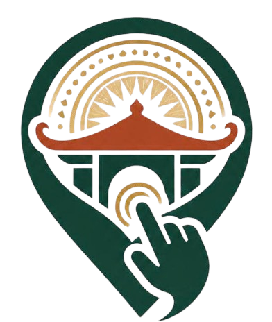

# THÁM VĂN — Sổ Tay Thực Địa & Khám Phá Di Sản Việt

**Đừng chỉ đến. Hãy chạm vào từng lớp ký ức, kiến trúc và câu chuyện đô thị.**

Nền tảng Web App & PWA đa ngôn ngữ (`vi` / `en` / `zh`) kết hợp mô hình **Đô thị 3D Three.js**, **Bản đồ vector MapLibre GL + OSRM/Overpass**, **Camera AI theo vị trí**, **Hành trình trải nghiệm Story Walks**, **Hộ chiếu thực địa & Thử thách XP** trên kiến trúc **Next.js 16 + Supabase PostgreSQL**.

<p>
  
  
  
  
  
  
  
</p>

<p>
  <a href="#video-trinh-dien-san-pham">Video Demo</a> &nbsp;|&nbsp;
  <a href="#thu-vien-giao-dien">Giao diện thực tế</a> &nbsp;|&nbsp;
  <a href="#tinh-nang-cot-loi">Tính năng cốt lõi</a> &nbsp;|&nbsp;
  <a href="#kien-truc-he-thong">Kiến trúc & Bảo mật</a> &nbsp;|&nbsp;
  <a href="#cai-dat-nhanh">Cài đặt nhanh</a> &nbsp;|&nbsp;
  <a href="#co-so-du-lieu-va-migrations">Database & Migrations</a>
</p>

<br />

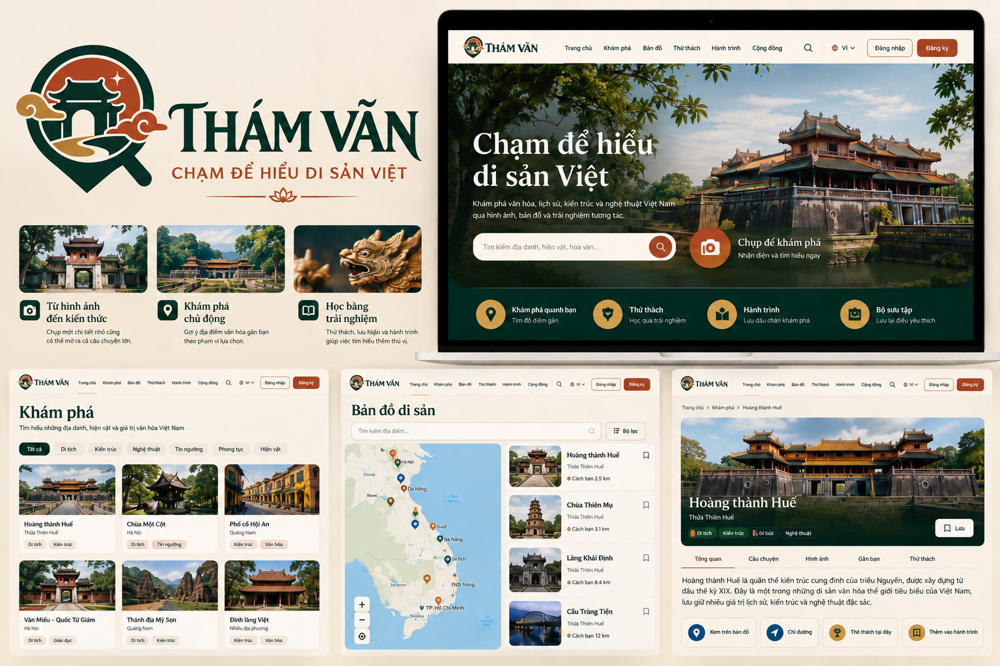

</div>

---

## Mục lục

1. [Tổng quan dự án](#tong-quan-du-an)
2. [Video trình diễn sản phẩm](#video-trinh-dien-san-pham)
3. [Thư viện giao diện thực tế](#thu-vien-giao-dien)
4. [Tính năng cốt lõi](#tinh-nang-cot-loi)
5. [Kiến trúc hệ thống & Luồng xử lý](#kien-truc-he-thong)
6. [Công nghệ sử dụng](#cong-nghe-su-dung)
7. [Cấu trúc thư mục](#cau-truc-thu-muc)
8. [Cài đặt nhanh & Biến môi trường](#cai-dat-nhanh)
9. [Cơ sở dữ liệu & Migrations (001 - 010)](#co-so-du-lieu-va-migrations)
10. [Xác thực, HumanCheck CAPTCHA & Phân quyền](#xac-thuc-va-bao-mat)
11. [Pipeline hình ảnh, 3D & Đánh giá AI](#pipeline-du-lieu)
12. [Kiểm thử & Vận hành thương mại](#kiem-thu-va-van-hanh)
13. [Tài liệu kỹ thuật chuyên sâu](#tai-lieu-ky-thuat)

---

<a id="tong-quan-du-an"></a>

## 1. Tổng quan dự án

**THÁM VĂN** là sổ tay thực địa số (Field Guide & Cultural Exploration Platform) phục vụ tra cứu, khám phá di sản, kiến trúc và nhịp sống đô thị TP. Hồ Chí Minh cùng các tuyến di sản Việt Nam qua trình duyệt máy tính và thiết bị di động (PWA).

| Trụ cột sản phẩm | Giá trị mang lại |
| --- | --- |
| **Khám phá có nguồn đối chiếu** | Danh mục địa điểm di sản phân nhóm rõ ràng (Di tích & lịch sử, Kiến trúc, Di sản thiên nhiên, Nghề thủ công, Biểu tượng & hoa văn, Lễ hội & cộng đồng), hiển thị mã lưu trữ, địa chỉ thực địa và ngày cập nhật tư liệu. |
| **Không gian 3D & Bản đồ thực** | Kết hợp mô hình đô thị Sài Gòn 3D nghệ thuật (Three.js) ở trang chủ với bản đồ vector thực tế (MapLibre GL + OpenFreeMap + Overpass + OSRM) hỗ trợ chỉ đường đa phương tiện và định vị GPS khi người dùng đồng ý. |
| **Camera AI gắn ngữ cảnh vị trí** | Nhận diện kiến trúc, bia ký, hoa văn và hiện vật qua ảnh chụp hoặc thư viện ảnh; đối chiếu địa danh lân cận theo bán kính thực tế (không gửi tọa độ thô cho model AI). |
| **Trải nghiệm & Gamification** | Hệ thống hành trình tự khám phá (Story Walks), Hộ chiếu thực địa (Explorer Passport), Check-in GPS trong bán kính 300 m, Thử thách trắc nghiệm cộng XP thăng cấp và sưu tầm huy hiệu. |
| **Vận hành hội viên & B2B** | Ba gói Free, Premium, Premium Family (tối đa 4 thành viên, AI lập lịch trình 1-7 ngày), tích hợp cổng thanh toán payOS (VietQR) và SePay (Visa/Mastercard) xác thực qua webhook HMAC/IPN phía máy chủ. |

---

<a id="video-trinh-dien-san-pham"></a>

## 2. Video trình diễn sản phẩm

Trình diễn trực quan các màn hình trọng tâm của THÁM VĂN: Trang chủ & Đô thị 3D Bạch Đằng / Landmark 81, Bản đồ MapLibre GL & Chỉ đường OSRM, Khối tòa nhà 3D & Quanh bạn Overpass, Hồ sơ di sản & Check-in GPS, Story Walks, My THÁM VĂN Passport Dashboard và giao diện Mobile PWA.

<div align="center">

<video src="docs/media/tham-van-showcase.mp4" controls muted playsinline width="100%" poster="asset/website-uiux.png"></video>

<br />

*Trường hợp trình duyệt hoặc trình đọc Markdown không phát trực tiếp thẻ `<video>`, bản xem nhanh dạng GIF được hiển thị bên dưới:*

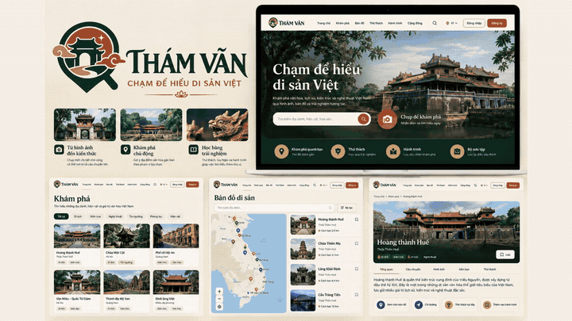

<p>
  <a href="docs/media/tham-van-showcase.mp4">Tải hoặc mở trực tiếp file video HD 1280x720 (tham-van-showcase.mp4)</a>
</p>

</div>

---

<a id="thu-vien-giao-dien"></a>

## 3. Thư viện giao diện thực tế

### 3.1. Giao diện Desktop Web

<table>
  <tr>
    <td width="50%" align="center">
      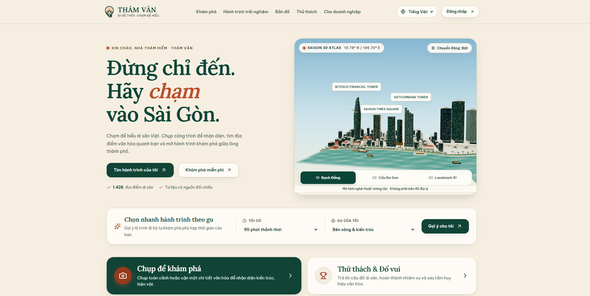
      <br />
      <strong>Trang chủ & Không gian Sài Gòn 3D</strong>
      <br />
      <sub>Hero 3D Three.js với 3 góc máy (Bạch Đằng, Cầu Ba Son, Landmark 81) cùng bộ chọn lộ trình nhanh theo quỹ thời gian.</sub>
    </td>
    <td width="50%" align="center">
      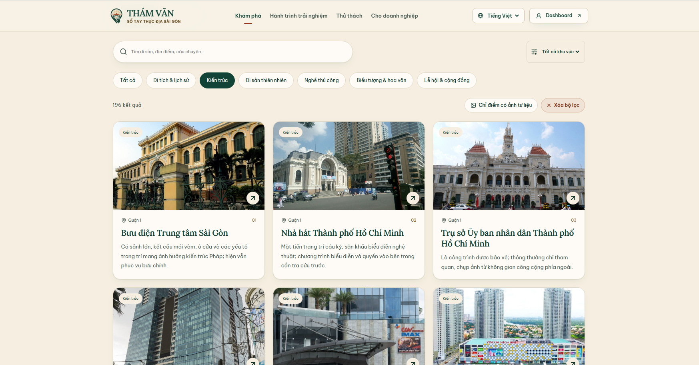
      <br />
      <strong>Danh mục Khám phá Di sản</strong>
      <br />
      <sub>Tìm kiếm và lọc theo 6 chủ đề văn hóa, khu vực quận/huyện và trạng thái ảnh tư liệu đã kiểm duyệt.</sub>
    </td>
  </tr>
  <tr>
    <td width="50%" align="center">
      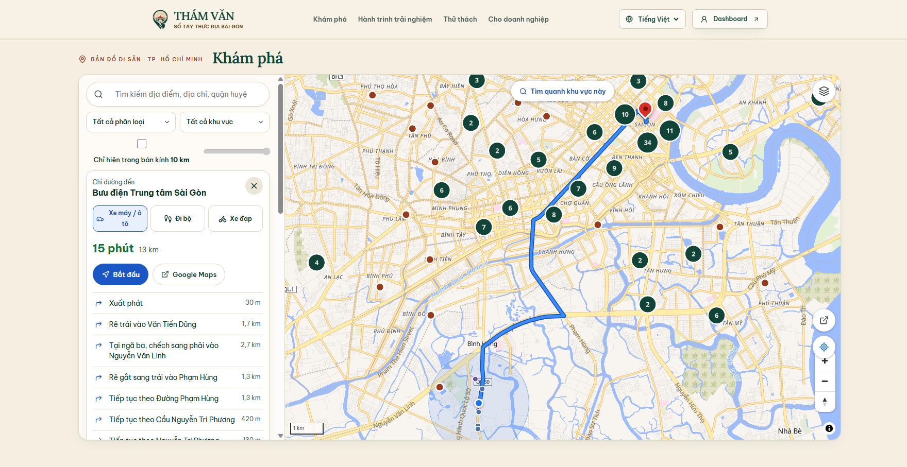
      <br />
      <strong>Bản đồ Di sản & Chỉ đường OSRM</strong>
      <br />
      <sub>Phân cụm marker theo mật độ, lọc bán kính và chỉ đường từng bước (xe máy/ô tô, đi bộ, xe đạp) từ vị trí hiện tại.</sub>
    </td>
    <td width="50%" align="center">
      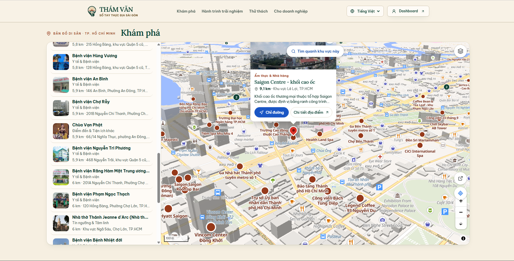
      <br />
      <strong>Bản đồ 3D & Khám phá quanh khu vực</strong>
      <br />
      <sub>Lớp dựng khối công trình 3D kết hợp truy vấn Overpass theo thời gian thực để tìm điểm đến thực tế xung quanh.</sub>
    </td>
  </tr>
  <tr>
    <td width="50%" align="center">
      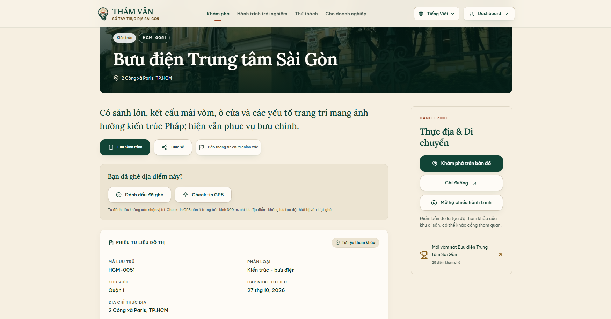
      <br />
      <strong>Hồ sơ Địa điểm & Check-in GPS</strong>
      <br />
      <sub>Phiếu tư liệu đô thị chi tiết (mã lưu trữ, phân loại, địa chỉ), đánh dấu đã ghé, Check-in GPS 300 m và thử thách gắn liền.</sub>
    </td>
    <td width="50%" align="center">
      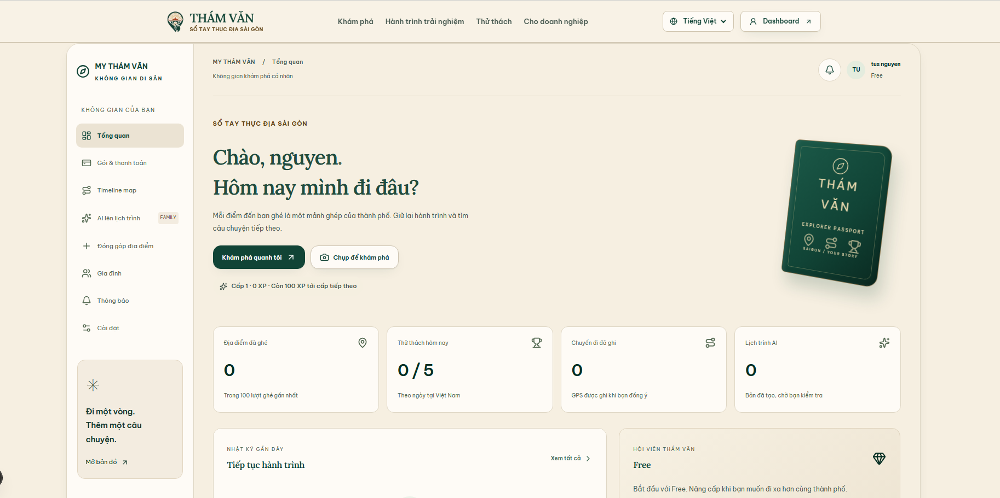
      <br />
      <strong>Không gian My THÁM VĂN & Explorer Passport</strong>
      <br />
      <sub>Bảng điều khiển cá nhân: Cấp độ XP, lượt ghé, thử thách ngày, Timeline Map, AI lên lịch trình Family và gói hội viên.</sub>
    </td>
  </tr>
</table>

### 3.2. Mô hình Đô thị TP. Hồ Chí Minh 3D (Three.js)

<table>
  <tr>
    <td width="33%" align="center">
      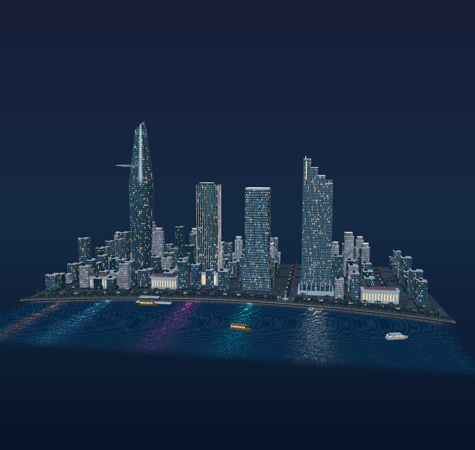
      <br />
      <strong>Bến Bạch Đằng (Chế độ Đêm)</strong>
      <br />
      <sub>Cụm Bitexco Financial Tower, Saigon Times Square, Hilton Saigon và Vietcombank Tower bên sông Sài Gòn.</sub>
    </td>
    <td width="33%" align="center">
      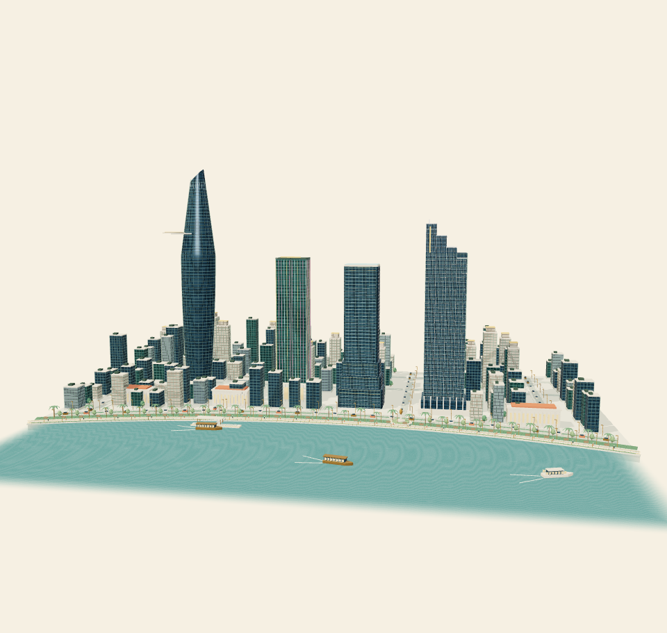
      <br />
      <strong>Bến Bạch Đằng (Ban ngày)</strong>
      <br />
      <sub>Ánh sáng môi trường PMREM tạo tại client, shader mặt nước và bến tàu waterbus chuyển động mượt.</sub>
    </td>
    <td width="33%" align="center">
      
      <br />
      <strong>Cụm Landmark 81 & Công viên</strong>
      <br />
      <sub>Phối cảnh bó tháp vươn cao, công viên ven sông và cụm căn hộ được tách module tải lười theo vùng hiển thị.</sub>
    </td>
  </tr>
</table>

### 3.3. Trải nghiệm Di động (Mobile PWA) & Hệ sinh thái Vận hành

<table>
  <tr>
    <td width="25%" align="center">
      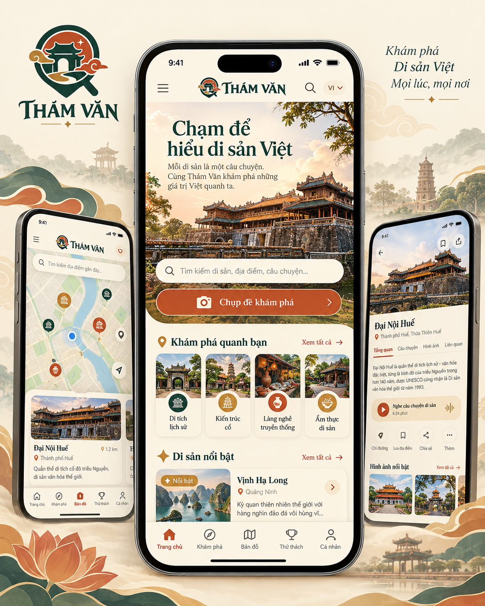
      <br />
      <sub>Tổng quan Mobile App & Bottom Navigation Bar</sub>
    </td>
    <td width="25%" align="center">
      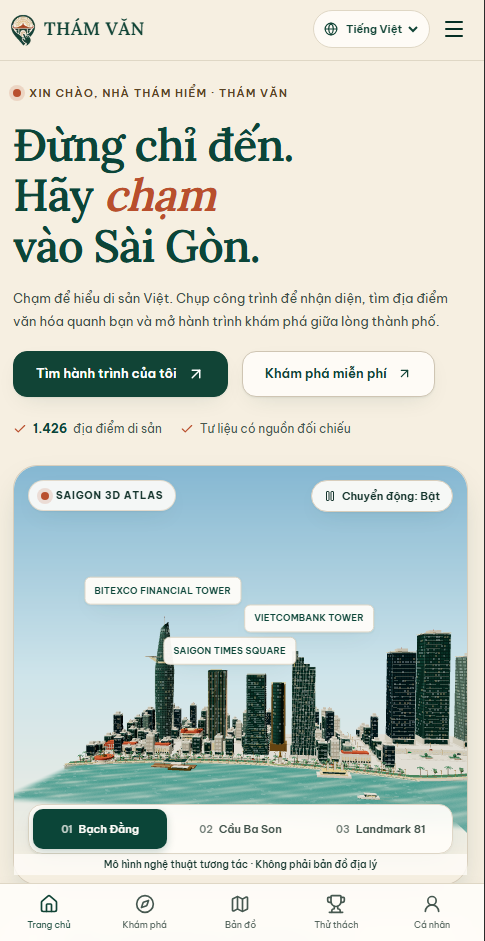
      <br />
      <sub>Hero 3D tối ưu cảm ứng trên màn hình dọc</sub>
    </td>
    <td width="25%" align="center">
      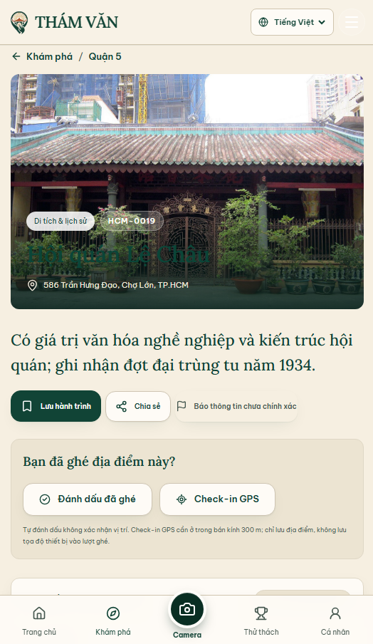
      <br />
      <sub>Chi tiết di sản Quận 5 & Check-in GPS thực địa</sub>
    </td>
    <td width="25%" align="center">
      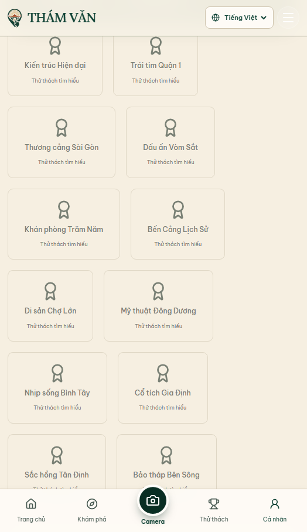
      <br />
      <sub>Bộ sưu tập Danh hiệu & Thử thách thực địa</sub>
    </td>
  </tr>
</table>

<details>
<summary><strong>Xem thêm ảnh: Hành trình Story Walks, Đăng nhập HumanCheck, Gói hội viên và Cổng Đối tác B2B</strong></summary>
<br />
<table>
  <tr>
    <td width="50%" align="center">
      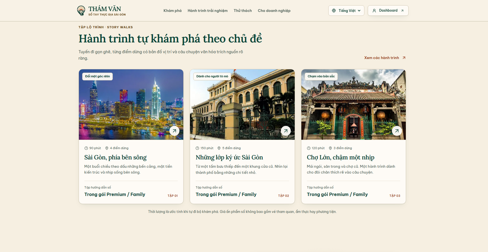
      <br />
      <strong>Tập lộ trình Story Walks</strong> — Các tuyến đi bộ theo chủ đề (Bến sông, Lớp ký ức, Chợ Lớn) kèm ước tính thời gian và số điểm dừng.
    </td>
    <td width="50%" align="center">
      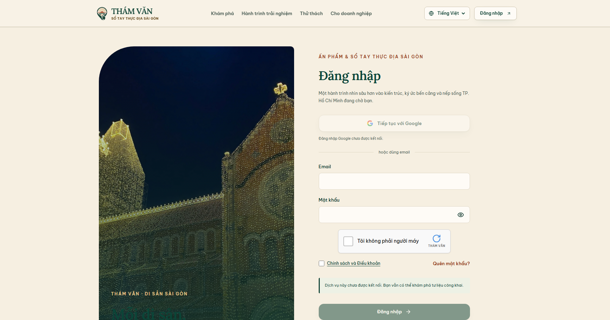
      <br />
      <strong>Đăng nhập & HumanCheck Slider</strong> — Hỗ trợ Google OAuth, Email/Mật khẩu kèm xác thực ghép hình 5 chủ đề tự vận hành.
    </td>
  </tr>
  <tr>
    <td width="50%" align="center">
      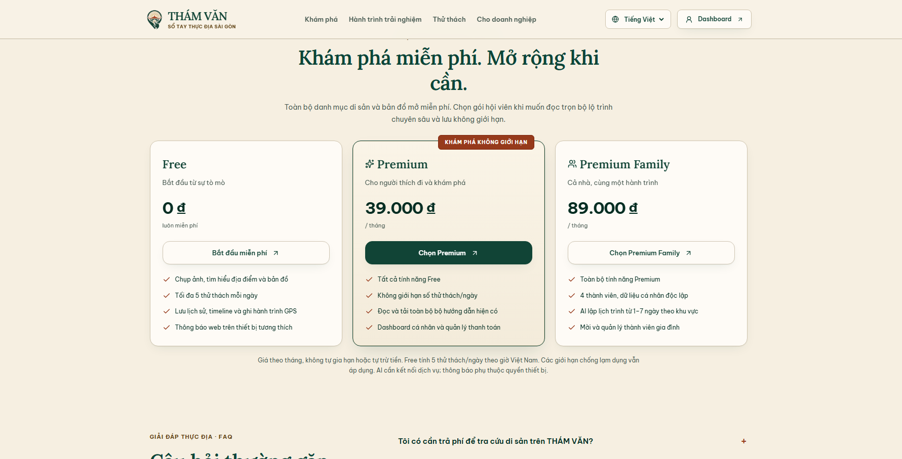
      <br />
      <strong>Bảng gói Hội viên</strong> — Free (0đ), Premium (39.000đ/tháng) và Premium Family (89.000đ/tháng cho 4 thành viên).
    </td>
    <td width="50%" align="center">
      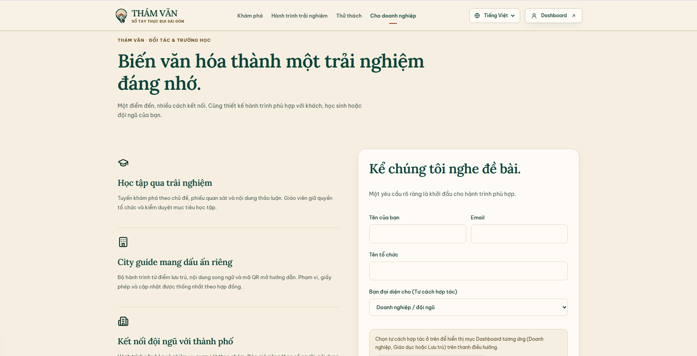
      <br />
      <strong>Cổng Đối tác & Trường học</strong> — Tiếp nhận đề bài thiết kế City Guide, học tập trải nghiệm và teambuilding văn hóa.
    </td>
  </tr>
</table>
</details>

---

<a id="tinh-nang-cot-loi"></a>

## 4. Tính năng cốt lõi

### 4.1. Khám phá Di sản, Bản đồ & Chỉ đường (`/[locale]/explore`, `/[locale]/map`)
- Hiển thị bản đồ vector **MapLibre GL** sử dụng style **OpenFreeMap** (3 chế độ nền: Bản đồ tiêu chuẩn, Tối giản, Vệ tinh).
- Truy vấn địa điểm thực lân cận trong bán kính 900 m qua **Overpass API** (`GET /api/nearby`) hỗ trợ đa máy chủ dự phòng và nút *"Tìm quanh khu vực này"*.
- Định tuyến chỉ đường thực tế qua **OSRM** (`GET /api/route?mode=driving|walking|cycling`), hỗ trợ hướng dẫn từng bước rẽ đa ngôn ngữ và tự động tính lại tuyến khi lệch > 70 m; không vẽ đường thẳng giả khi máy chủ định tuyến gián đoạn.
- Định vị GPS độ chính xác cao từ thiết bị (`watchPosition` trong `src/lib/device-location.ts`), tuyệt đối không suy đoán vị trí qua IP và không in tọa độ thô ra giao diện.

### 4.2. THÁM VĂN Lens — Camera AI theo Ngữ cảnh (`/[locale]/camera`, `POST /api/recognize`)
- Cổng xin quyền một lần cho mỗi thiết bị (`src/components/permission-gate.tsx`), lưu trạng thái đồng ý tại `localStorage['tv-device-consent']`.
- Trình chụp toàn màn hình hỗ trợ zoom 1x / 2x / 3x (tự cắt khung nếu dùng zoom số), đổi camera trước/sau, bật/tắt đèn flash và tải ảnh từ thư viện.
- Tiền xử lý ảnh an toàn phía server bằng `sharp`: kiểm tra chữ ký file, giới hạn 5 MB, chuẩn hóa kích thước tối đa 1600 px (trần 24 MP) và xóa toàn bộ metadata EXIF trước khi gửi model Vision (`deepseek-ai/deepseek-v4.1-flash-1017` qua TheHive API).
- Xử lý song song **Vision bước 1** + **Ngữ cảnh địa điểm** (`src/lib/place-context.ts` qua Nominatim & Overpass). Model chỉ nhận tên khu vực và khoảng cách, **không bao giờ nhận tọa độ GPS**.
- Áp dụng giới hạn bảo vệ tài nguyên trong PostgreSQL (`10 lượt nhận diện / 24 giờ / tài khoản`, timeout 45 giây).

### 4.3. Hành trình Trải nghiệm, Hộ chiếu & Thử thách (`/[locale]/experiences`, `/[locale]/challenges`, `/[locale]/profile`)
- **Story Walks**: Các tập hướng dẫn đi bộ theo chủ đề kèm lộ trình điểm dừng, bản đồ vị trí và nội dung đối chiếu nguồn.
- **Thử thách thực địa & XP**: Trả lời câu hỏi trắc nghiệm di sản thông qua RPC bảo mật trong schema `private` (row lock chống cộng điểm lặp, giới hạn Free 5 thử thách/ngày theo múi giờ Việt Nam).
- **Check-in GPS & Nhật ký hành trình**: Ghi nhận lượt ghé trong bán kính 300 m, lưu timeline map tối đa 2.000 điểm khi tab đang mở và hỗ trợ xuất video hành trình trên trình duyệt hỗ trợ `MediaRecorder`.

### 4.4. Hội viên, Thanh toán & Không gian Quản trị (`/[locale]/dashboard`, `/[locale]/admin`)
- **My THÁM VĂN (`/[locale]/dashboard`)**: Quản lý gói hội viên, lịch sử đơn hàng, lời mời nhóm **Family** (tối đa chủ hộ + 3 thành viên qua token dùng 1 lần trong 7 ngày), lập lịch trình du lịch bằng AI (1-7 ngày), đóng góp địa điểm mới và nhận Web Push notification (VAPID).
- **Thanh toán đa kênh**: Hỗ trợ chuyển khoản VietQR qua **payOS** (`POST /api/payments/payos`) và thẻ quốc tế Visa/Mastercard qua **SePay Payment Gateway** (`POST /api/payments/sepay`). Quyền hội viên chỉ kích hoạt sau khi chữ ký HMAC/IPN, số tiền, loại tiền và mã đơn được đối soát ở PostgreSQL. Có công tắc `payments_live` trong bảng `app_settings` (migration `010`) để bật/tắt chế độ xem trước.
- **Admin Workspace (`/[locale]/admin`, `/[locale]/admin/dashboard`, `/[locale]/admin/commerce`)**: Thống kê doanh thu, sổ giao dịch membership, chỉ số XP người dùng (`admin_xp_summary`), phê duyệt địa điểm đóng góp, quản lý chi phí/phí cổng và đọc hộp thư đối tác B2B.

---

<a id="kien-truc-he-thong"></a>

## 5. Kiến trúc hệ thống & Luồng xử lý

Toàn bộ yêu cầu đi qua lớp biên `src/proxy.ts` (Next.js 16) để kiểm soát **bắt buộc đăng nhập toàn site**, phát sinh **CSP Nonce động theo từng request**, xác thực phiên `@supabase/ssr` và áp dụng chính sách công khai tối thiểu từ `src/lib/access-policy.ts`.

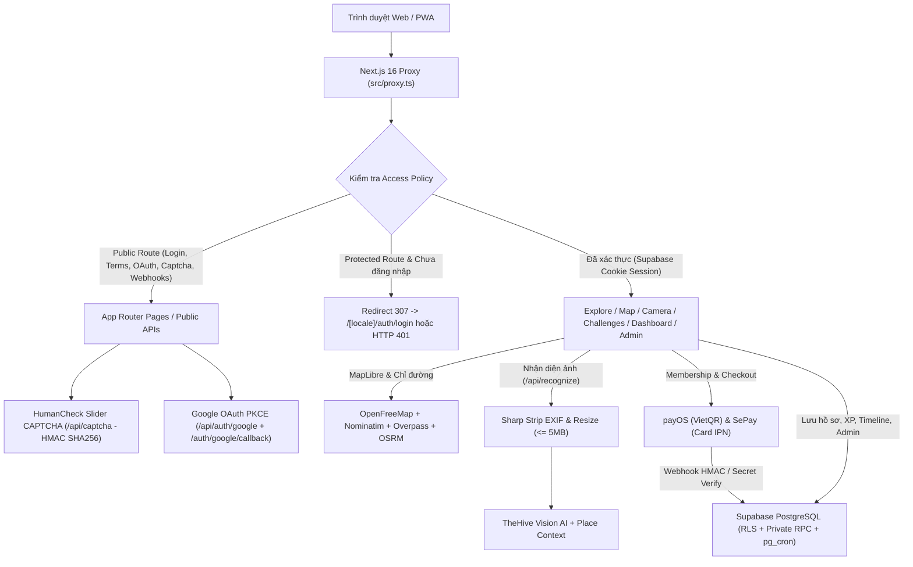

### Bảo mật & Ranh giới tin cậy (Defense-in-Depth)
- **Không dùng Supabase Browser Client**: Toàn bộ phiên làm việc lưu qua cookie `HttpOnly` trên server; module DAL và secrets gắn `server-only`, không rò rỉ `SUPABASE_SERVICE_ROLE_KEY`, `THEHIVE_API_KEY`, `PAYOS_*` hay `SEPAY_*` ra client bundle.
- **CSP Strict Nonce & Security Headers**: Sinh nonce ngẫu nhiên cho từng HTTP response, `strict-dynamic`, chặn `object-src`/`frame-ancestors`, đặt `Cache-Control: private, no-store` cho dữ liệu động.
- **Chống CSRF & Fake Origin**: Các API ghi dữ liệu kiểm tra Same-Origin / Fetch Metadata dựa trên `NEXT_PUBLIC_SITE_URL` và validate schema đầu vào 100% với **Zod v4**.
- **PostgreSQL RLS & Row-Level Locking**: Không cho client ghi trực tiếp điểm thưởng hay trạng thái đơn; toàn bộ đáp án thử thách nằm ở schema `private` và xử lý qua RPC có khóa dòng chống race condition hoặc cộng lặp.

---

<a id="cong-nghe-su-dung"></a>

## 6. Công nghệ sử dụng

| Lớp hệ thống | Công nghệ & Phiên bản (`package.json`) | Vai trò |
| --- | --- | --- |
| **Core Framework** | `next` `16.4.3`, `react` `19.3.1`, `typescript` `6.0.3` | App Router, Server Components, Server Actions, Proxy Middleware |
| **Bản đồ & Không gian 3D** | `maplibre-gl` `6.18.0`, `three` `0.186.1` | Bản đồ vector 3D buildings, OSRM routing, Đô thị Sài Gòn 3D WebGL |
| **Cơ sở dữ liệu & Auth** | `@supabase/ssr` `0.12.7`, `@supabase/supabase-js` `2.118.0` | PostgreSQL RLS, Email/Password, Google OAuth PKCE, Session Cookies |
| **Xử lý Ảnh & AI Vision** | `sharp` `0.35.5`, TheHive Chat Completions (`deepseek-v4.1-flash-1017`) | Kiểm tra định dạng, resize/xóa EXIF ảnh, nhận diện di sản & AI Planner |
| **Validation & Bảo mật** | `zod` `4.6.7`, HMAC-SHA256 Self-Hosted HumanCheck | Validate payload API, chống bot login/register, ký/xác thực webhook |
| **Thông báo & Phông chữ** | `web-push` `3.6.7`, `@fontsource/be-vietnam-pro`, `@fontsource/lora` | Web Push VAPID (PWA), Typography editorial không phụ thuộc CDN ngoài |
| **UI Icons** | `lucide-react` `1.61.0` | Bộ biểu tượng vector chuẩn trên giao diện ứng dụng |
| **Kiểm thử & Tự động hóa** | `vitest` `5.0.5`, `@playwright/test` `1.64.1`, `@electric-sql/pglite` `0.5.12`, `@axe-core/playwright` `4.14.0` | Unit test, kiểm thử SQL/RLS cục bộ không cần cloud, E2E trình duyệt & Accessibility WCAG |

---

<a id="cau-truc-thu-muc"></a>

## 7. Cấu trúc thư mục

```text
d:\thamvan-moi
├── asset/                          # Logo thương hiệu, mockup UI/UX và render 3D Sài Gòn (asset/city/)
├── docs/                           # Tài liệu kỹ thuật (AI, Commerce, Google Auth, 3D, Security, Media)
│   └── media/                      # Video showcase (.mp4) và GIF preview phục vụ README
├── prompts/                        # Prompt điều chỉnh suy luận AI nhận diện thực địa (recognition.md)
├── public/                         # Tài nguyên tĩnh (ảnh di sản, ảnh website/mobile, maplibre-gl-worker.mjs)
├── scripts/                        # Công cụ CLI: audit/thu thập ảnh, render 3D poster, check-env, grant-admin, seed
├── src/
│   ├── app/
│   │   ├── api/                    # Route Handlers: auth, captcha, recognize, nearby, route, checkout, payments, admin...
│   │   ├── auth/                   # OAuth callbacks (/auth/callback, /auth/confirm, /auth/google/callback)
│   │   └── [locale]/               # Các trang ứng dụng đa ngôn ngữ (vi, en, zh): home, explore, map, camera, dashboard, admin...
│   ├── components/                 # UI components (HumanCheck, PermissionGate, MapCanvas, CityCanvas, AuthForm...)
│   ├── lib/                        # Logic nghiệp vụ: access-policy, auth, supabase server/admin, place-context, vision, payOS/SePay
│   └── proxy.ts                    # Next.js 16 Middleware: CSP Nonce, i18n locale, ép buộc đăng nhập toàn hệ thống
├── supabase/
│   ├── migrations/                 # 10 file SQL migration tuần tự từ 001 đến 010
│   └── seed.sql                    # Dữ liệu mẫu khởi tạo (di sản & thử thách)
├── tests/                          # Unit tests (Vitest + PGlite) & E2E tests (Playwright + Axe)
├── .env.example                    # Mẫu toàn bộ biến môi trường bắt buộc và tùy chọn
└── package.json                    # Khai báo dependencies và 20+ npm scripts vận hành
```

---

<a id="cai-dat-nhanh"></a>

## 8. Cài đặt nhanh & Biến môi trường

### 8.1. Yêu cầu môi trường
- **Node.js**: `>= 22.13.0` (đã xác minh cùng `npm@11.12.1`)
- **Supabase Project** (Cloud hoặc Supabase CLI local)
- **Tài khoản / API Keys tùy tính năng**: TheHive AI (Camera AI & Lịch trình AI), Google Cloud OAuth Client, payOS (VietQR), SePay (Thẻ quốc tế), VAPID keys (Web Push).

### 8.2. Khởi chạy cục bộ

```powershell
# 1. Cài đặt dependencies
npm install

# 2. Tạo file cấu hình môi trường từ mẫu
Copy-Item .env.example .env.local

# 3. Kiểm tra cấu hình biến môi trường
npm run env:check

# 4. Chạy môi trường phát triển (mặc định http://127.0.0.1:3000)
npm run dev
```

### 8.3. Nhóm biến môi trường chính (`.env.example`)

<details>
<summary><strong>Xem chi tiết cấu hình biến môi trường theo từng phân hệ</strong></summary>

| Nhóm cấu hình | Biến môi trường tiêu biểu | Ghi chú bảo mật & Vận hành |
| --- | --- | --- |
| **Origin & Supabase** | `NEXT_PUBLIC_SITE_URL`, `NEXT_PUBLIC_SUPABASE_URL`, `NEXT_PUBLIC_SUPABASE_PUBLISHABLE_KEY`, `SUPABASE_SERVICE_ROLE_KEY`, `SUPABASE_JWT_SECRET` | Không bao giờ gắn tiền tố `NEXT_PUBLIC_` cho `SERVICE_ROLE_KEY` hay `JWT_SECRET`. |
| **HumanCheck CAPTCHA** | `CAPTCHA_SECRET` | Khóa HMAC `>= 32` ký tự dùng cho slider CAPTCHA tự vận hành (tự suy xuất từ `SUPABASE_JWT_SECRET` nếu bỏ trống). |
| **Google OAuth** | `AUTH_GOOGLE_ENABLED`, `AUTH_GOOGLE_FLOW` (`direct` \| `supabase`), `GOOGLE_CLIENT_ID`, `GOOGLE_CLIENT_SECRET` | URI chuyển hướng cho chế độ `direct`: `<NEXT_PUBLIC_SITE_URL>/auth/google/callback`. |
| **AI Vision & Planner** | `THEHIVE_API_KEY`, `VISION_MODEL`, `VISION_PROMPT_FILE`, `VISION_MAX_OUTPUT_TOKENS`, `ITINERARY_MODEL` | Mặc định dùng `deepseek-ai/deepseek-v4.1-flash-1017` và prompt tại `prompts/recognition.md`. |
| **Bản đồ & Định tuyến** | `NEXT_PUBLIC_MAP_STYLE_URL`, `ROUTING_API_URL`, `GEOCODER_API_URL`, `OVERPASS_API_URL` | Để trống sẽ dùng dịch vụ công cộng miễn phí (OpenFreeMap, Nominatim, Overpass, OSRM). Khuyến nghị tự host cho production. |
| **Thương mại & Thanh toán** | `COMMERCE_ENABLED`, `COMMERCE_SUPPORT_EMAIL`, `PAYOS_CLIENT_ID`, `PAYOS_API_KEY`, `PAYOS_CHECKSUM_KEY`, `SEPAY_CARD_ENABLED`, `SEPAY_MERCHANT_ID`, `SEPAY_SECRET_KEY`, `SEPAY_IPN_SECRET` | Mặc định `COMMERCE_ENABLED=false` và `SEPAY_CARD_ENABLED=false` cho tới khi kiểm thử đối soát webhook thực. |
| **Web Push & Admin** | `NEXT_PUBLIC_VAPID_PUBLIC_KEY`, `VAPID_PRIVATE_KEY`, `VAPID_SUBJECT`, `ADMIN_EMAIL`, `ADMIN_PASSWORD` | Sinh cặp khóa VAPID bằng `npx web-push generate-vapid-keys`; cấp quyền Admin qua `npm run admin:grant`. |

</details>

---

<a id="co-so-du-lieu-va-migrations"></a>

## 9. Cơ sở dữ liệu & Migrations (`001` - `010`)

Hệ thống sử dụng kiến trúc **Database-First** trên PostgreSQL của Supabase. Toàn bộ migration được thiết kế tăng tiến (additive) — khi triển khai project mới, chạy tuần tự từ `001` đến `010` trong Supabase SQL Editor rồi chạy `supabase/seed.sql`.

| Thứ tự | Tên file migration | Phạm vi chức năng |
| --- | --- | --- |
| `001` | `202610260001_initial.sql` | Bảng lõi: hồ sơ người dùng, danh mục di sản, thử thách thực địa, tiến trình XP, báo cáo địa điểm, `user_roles` và chính sách RLS ban đầu. |
| `002` | `202610260002_retention.sql` | Lịch dọn dẹp dữ liệu định kỳ (`pg_cron`), giới hạn lưu trữ nhật ký và chính sách retention. |
| `003` | `202610270003_google_auth_consent.sql` | Hỗ trợ luồng Google OAuth PKCE và bắt buộc lưu xác nhận điều khoản sử dụng trước khi kích hoạt quyền truy cập. |
| `004` | `202610270004_commerce.sql` | Cấu trúc đơn hàng bộ hướng dẫn số, SKU, khóa giao dịch payOS và hàm ghi nhận hoàn tiền `record_commerce_refund`. |
| `005` | `202610280005_memberships.sql` | Hệ thống 3 gói hội viên (Free / Premium / Family), membership ledger, nhóm gia đình tối đa 4 người và token mời. |
| `006` | `202610280006_explorer_workspace.sql` | Không gian người dùng: lượt ghé, check-in GPS, điểm ghi hành trình (`travel_points`), lịch trình AI Family và Web Push subscriptions. |
| `007` | `202610280007_operations.sql` | Vận hành đa cổng thanh toán (phân phối payOS + SePay IPN), sổ phí/chi phí thực tế, đóng góp địa điểm và thông báo admin. |
| `008` | `202610280008_catalog_bookmarks.sql` | Cho phép đánh dấu lưu hành trình đối với các định danh địa điểm cục bộ trong danh mục TP.HCM. |
| `009` | `202610280009_admin_xp_summary.sql` | RPC `public.admin_xp_summary()` (kiểm tra `is_admin()`) tổng hợp XP, số thử thách hoàn tất, số người khám phá và cấp cao nhất. |
| `010` | `202611150010_app_settings.sql` | Bảng `public.app_settings` quản lý cờ vận hành (mặc định `payments_live=false` giữ checkout ở chế độ xem trước an toàn). |

### Cấp quyền Quản trị viên (Admin)
Không tạo tài khoản admin mặc định trong mã nguồn và không cấp từ giao diện đăng ký khách. Sau khi tài khoản đã tồn tại, cấp quyền bằng CLI hoặc SQL an toàn:

```powershell
# Cấu hình ADMIN_EMAIL và ADMIN_PASSWORD trong .env.local rồi chạy:
npm run admin:grant
```

---

<a id="xac-thuc-va-bao-mat"></a>

## 10. Xác thực, HumanCheck CAPTCHA & Phân quyền

### 10.1. Chế độ Khóa Truy Cập Toàn Site (Strict Auth Gate)
Theo `src/proxy.ts` và `src/lib/access-policy.ts`, mọi trang chức năng và API nghiệp vụ đều **yêu cầu đăng nhập trước khi sử dụng**:
- **Các tuyến công khai tối thiểu**:
  - Trang chào gốc `/`
  - Trang xác thực & pháp lý: `/{vi|en|zh}/auth/(login|register|forgot|reset)`, `/{vi|en|zh}/(terms|privacy|credits)`, `/auth/(callback|confirm|google/callback)`
  - API công khai bắt buộc: `/api/auth`, `/api/auth/google`, `/api/captcha`, `/api/assistant` (Sổ tay hỏi đáp), `/api/payments/(payos|sepay)`
- **Hành vi chuyển hướng thông minh**: Các trang khác nếu chưa có phiên hợp lệ sẽ chuyển hướng tạm thời (`307`) tới `/{locale}/auth/login?next=...` (trừ yêu cầu `fetch`/API sẽ nhận HTTP `401` kèm mã `authRequired` thay vì redirect HTML).

### 10.2. Self-Hosted HumanCheck Slider CAPTCHA (`src/components/human-check.tsx`)
Thay thế hoàn toàn widget bên thứ ba phụ thuộc khóa mạng ngoài bằng cơ chế **Slider Puzzle 5 mẫu SVG nội bộ** có chữ ký HMAC-SHA256 tại `/api/captcha`:
- 5 chủ đề văn hóa Việt: *Hoàng hôn Sài Gòn*, *Hồ sen*, *Đèn lồng đêm hội*, *Sông nước miền Tây*, *Gạch bông*.
- Khi người dùng tích chọn *"Tôi không phải người máy"*, khung kéo mảnh ghép bật ra để kiểm chứng vị trí khớp chính xác trên server trước khi cấp token xác nhận 1 lần.

---

<a id="pipeline-du-lieu"></a>

## 11. Pipeline hình ảnh, 3D & Đánh giá AI

`package.json` cung cấp bộ scripts chuẩn hóa dữ liệu địa điểm, ảnh tư liệu và ảnh dự phòng 3D:

| Lệnh npm | Mục đích thực thi |
| --- | --- |
| `npm run assets:sync` | Đồng bộ và kiểm tra tài nguyên từ `asset/` vào hệ thống tĩnh `public/`. |
| `npm run images:audit` | Kiểm tra tính hợp lệ, kích thước, trạng thái thiếu ảnh của toàn bộ catalog địa điểm TP.HCM. |
| `npm run images:discover` / `images:wikipedia` / `images:sources` | Thu thập, đối chiếu nguồn mở (Wikimedia/Wikipedia/nguồn mở có bản quyền rõ ràng). |
| `npm run images:repair` / `images:galleries` / `images:web` / `images:finalize` | Sửa liên kết ảnh hỏng, tạo gallery và đóng gói bộ thư viện ảnh web chuẩn hóa. |
| `npm run city:poster` | Chạy headless Chromium (Playwright) render lại 6 ảnh 3D Sài Gòn (3 cảnh x 2 chế độ ngày/đêm) vào `asset/city/` và chuyển WebP sang `public/images/`. |
| `npm run db:seed:generate` | Tạo lại dữ liệu `supabase/seed.sql` từ nguồn catalog đã kiểm duyệt. |
| `npm run vision:eval` | Đánh giá chất lượng và tính nhất quán JSON đầu ra của pipeline nhận diện Camera AI. |

---

<a id="kiem-thu-va-van-hanh"></a>

## 12. Kiểm thử & Vận hành thương mại

### 12.1. Các lệnh kiểm tra chất lượng

```powershell
# Kiểm tra ESLint + TypeScript typecheck
npm run check

# Hoặc chạy riêng từng bước:
npm run lint
npm run typecheck

# Chạy Unit tests & kiểm tra SQL/RLS cục bộ trên PGlite (Vitest)
npm test

# Chạy E2E tests trên trình duyệt thực (Playwright + Axe Accessibility)
npm run test:e2e

# Build bản production (Webpack mode chuẩn của dự án)
npm run build
npm run start
```

### 12.2. Checklist trước khi bật thu tiền thật (`COMMERCE_ENABLED=true`)
1. Áp dụng đầy đủ migrations `001` đến `010` trên Supabase Production và bật lịch `pg_cron` retention.
2. Cấu hình `NEXT_PUBLIC_SITE_URL` là domain HTTPS chính thức; cấu hình SMTP gửi mail xác thực và Google OAuth Redirect URIs.
3. Đối soát thử giao dịch giá trị nhỏ qua **payOS** và **SePay** với webhook/IPN thực; xác minh trường hợp gửi lặp webhook, sai chữ ký và hoàn tiền qua `refund_plan_order` / `record_commerce_refund`.
4. Chuyển công tắc `payments_live` trong Admin Dashboard khi toàn bộ quy trình hỗ trợ và pháp lý (`COMMERCE_SUPPORT_EMAIL`) đã sẵn sàng.

---

<a id="tai-lieu-ky-thuat"></a>

## 13. Tài liệu kỹ thuật chuyên sâu

| Tài liệu | Nội dung chi tiết |
| --- | --- |
| [docs/AI-RECOGNITION.md](docs/AI-RECOGNITION.md) | Kiến trúc THÁM VĂN Lens, luồng song song Vision + Nominatim/Overpass và cấu hình bản đồ MapLibre / OSRM |
| [docs/HCM-3D.md](docs/HCM-3D.md) | Chi tiết mô hình Sài Gòn 3D Three.js, shader sông, chiếu sáng PMREM và phương án dự phòng |
| [docs/GOOGLE-AUTH.md](docs/GOOGLE-AUTH.md) | Thiết lập Google OAuth PKCE, Redirect URIs giữa Google Cloud - Supabase - Next.js và sequence diagram |
| [docs/COMMERCE-SETUP.md](docs/COMMERCE-SETUP.md) | Quy trình kích hoạt payOS, chống tạo đơn spam, hoàn tiền và đối soát giao dịch |
| [docs/MEMBERSHIP-OPERATIONS.md](docs/MEMBERSHIP-OPERATIONS.md) | Vận hành 3 gói hội viên, SePay Payment Gateway IPN, nhóm Family, Web Push và các giới hạn kỹ thuật công bố |
| [docs/SECURITY.md](docs/SECURITY.md) | Ma trận ranh giới tin cậy, cấu hình CSP Nonce, rate-limit PostgreSQL và checklist vận hành an toàn |
| [docs/PLACE-IMAGES.md](docs/PLACE-IMAGES.md) | Quy chuẩn bản quyền ảnh địa điểm, quy trình kiểm duyệt và sử dụng pipeline `images:*` |
| [docs/TEST-REPORT.md](docs/TEST-REPORT.md) | Báo cáo kiểm thử tổng thể sản phẩm |

---

<div align="center">

**THÁM VĂN** — Bảo tồn ký ức đô thị bằng công nghệ bản đồ, thị giác máy tính và tư liệu đối chiếu.

</div>
