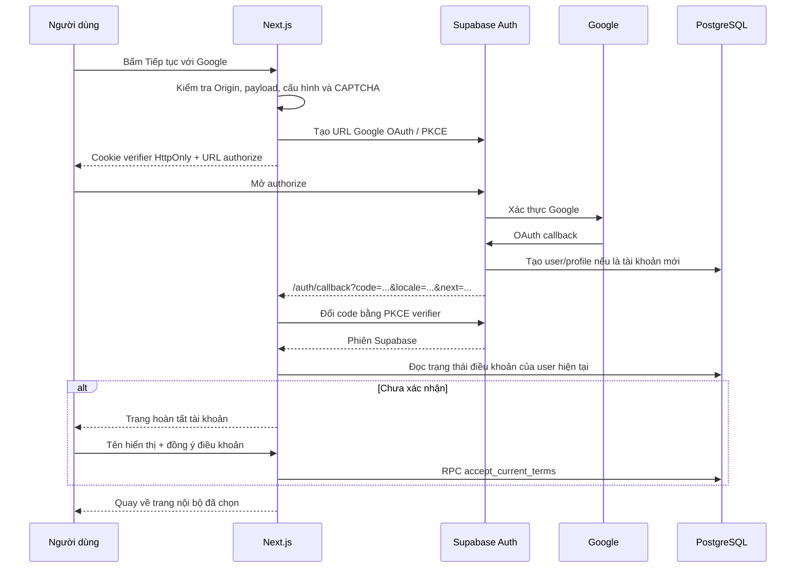

# Đăng nhập Google cho THÁM VĂN

## Thiết lập

Triển khai qua Google provider của Supabase, dùng `@supabase/ssr` và PKCE. Không cần Google JavaScript SDK hoặc lưu Google Client Secret trong web client. Theo [hướng dẫn chính thức của Supabase](https://supabase.com/docs/guides/auth/social-login/auth-google).

1. Trong `.env`, điền `NEXT_PUBLIC_SUPABASE_URL`, `NEXT_PUBLIC_SUPABASE_PUBLISHABLE_KEY` và `NEXT_PUBLIC_SITE_URL` đúng origin của web. Local dùng `http://localhost:3000`.
2. Chạy SQL trong Supabase SQL Editor:
   - Project mới: `202610260001_initial.sql` → `202610260002_retention.sql` → **`202610270003_google_auth_consent.sql`** → `supabase/seed.sql`.
   - Project đã có 001/002: chỉ chạy **003**. Không xóa dữ liệu hoặc chạy lại 001.
3. Trong Google Cloud Console → Google Auth Platform, cấu hình màn hình consent, audience và OAuth client loại **Web application**. Dùng các scope nhận diện cơ bản email/profile; không yêu cầu Drive, Contacts hoặc quyền API khác. Khi app còn Testing, thêm các tài khoản cần thử vào Test users nếu audience yêu cầu.
4. Authorized JavaScript origins: origin web (`http://localhost:3000` và domain HTTPS thực tế).
5. Authorized redirect URIs của Google: **callback Supabase**, lấy chính xác trong Dashboard, dạng:

   ```text
   https://YOUR_PROJECT_REF.supabase.co/auth/v1/callback
   ```

   Đây là địa chỉ Google gọi về Supabase. Không thay bằng `/auth/callback` của Next.js. Nếu dùng custom Auth domain, sao chép callback do Dashboard hiển thị.

6. Supabase → Authentication → Sign In / Providers → Google: bật provider và nhập Client ID, Client Secret vừa tạo. Client Secret ở đây được Supabase Auth sử dụng; không lưu vào bảng `profiles`, không đặt vào `NEXT_PUBLIC_*`.
7. Supabase → Authentication → URL Configuration:
   - Site URL: `http://localhost:3000` khi local, domain HTTPS khi production.
   - Redirect URLs: callback **ứng dụng Next.js**, bao gồm query do app tạo, ví dụ local `http://localhost:3000/auth/callback**`. Production dùng domain chính xác, giới hạn đường dẫn `/auth/callback` và cho phép query cần thiết. Cấu hình `/auth/confirm` cho email theo README.
   - Các tham số `next` và `locale` được app kiểm tra lại; không dùng origin do request Host tự khai báo.
8. Đặt trong `.env`:

   ```dotenv
   AUTH_GOOGLE_ENABLED=true
   ```

9. Nếu production: cấu hình cả Turnstile site key và secret theo README. Nút Google dùng chung bước xác minh bảo mật với đăng nhập email. Không bật đồng thời Supabase CAPTCHA riêng nếu chưa tích hợp token tương ứng.
10. Khởi động lại dev server. Khi production, chạy lại build và start. Mở `/vi/auth/login`, `/en/auth/login` hoặc `/zh/auth/login`.

Các URL ở bước 5 và 7 là hai đầu của cùng luồng, có mục đích khác nhau. Nếu dùng Supabase CLI local, callback của Google sẽ là URL Auth local được Supabase cung cấp, thường `http://127.0.0.1:54321/auth/v1/callback`; cần cấu hình provider trong Supabase local thay vì Dashboard hosted.

## Luồng xử lý



Ảnh hưởng đến tài khoản đã có: app dựa vào UUID do Supabase Auth trả về, không tự ghép hồ sơ bằng email hoặc metadata từ Google. Việc liên kết identity được giao cho [cơ chế identity linking của Supabase](https://supabase.com/docs/guides/auth/auth-identity-linking). Khi kiểm thử tài khoản email đã có, phải xác nhận Supabase trả cùng UUID và dữ liệu hành trình được giữ nguyên.

## SQL 003 thay đổi gì

- Thay trigger `on_auth_user_created` để nhận Google từ `raw_app_meta_data.provider` do Auth quản lý. Không tin `provider` hoặc `role` trong `raw_user_meta_data` mà người dùng có thể sửa.
- Tài khoản Google mới có hồ sơ lấy tên hiển thị từ Google, **chưa có** `terms_version`/`consented_at`, kể cả metadata Google tình cờ có trường tương tự. Không tự cấp admin.
- Đăng ký email tiếp tục yêu cầu xác nhận phiên bản điều khoản qua luồng hiện có.
- Giữ nguyên hồ sơ, thời điểm đồng ý, saved places và điểm của người dùng cũ. Auth account thiếu profile được backfill với trạng thái chưa xác nhận; không dựng thời điểm đồng ý giả.
- RPC `accept_current_terms` chỉ cập nhật user có `auth.uid()` hiện tại, kiểm tra phiên bản/tên/ngôn ngữ, ghi timestamp server. Gọi lặp không làm mất thời điểm đồng ý đầu tiên của cùng phiên bản.
- RLS cho lưu hành trình và các RPC thử thách/báo sai/quota AI đều yêu cầu đồng ý điều khoản. Các implementation cũ được đưa vào schema private và bị thu hồi quyền gọi trực tiếp; wrapper công khai giữ nguyên tên/tham số.
- Migration được kiểm thử chạy lại 003; không chạy lại 001/002 khi database đã được khởi tạo.

Không có SQL nào tự bật Google provider hoặc tạo Google Client ID/Secret. Cấu hình đó thuộc Google Cloud và Supabase Auth Dashboard.

## Phiên, lỗi và xóa tài khoản

- PKCE verifier ở cookie HttpOnly; đổi code diễn ra ở server. Không đưa access/refresh token vào localStorage hoặc query trả về app.
- Callback xử lý hủy quyền, code hết hạn/đã dùng, cấu hình thiếu và profile lỗi. Không hiển thị raw provider errors, code hay token. Giữ ngôn ngữ và route nội bộ hợp lệ; chặn redirect ra ngoài và vòng lặp login/consent.
- Người chưa xác nhận được chuyển đến `/[locale]/auth/consent`; vẫn đọc được điều khoản/quyền riêng tư và đăng xuất. API và SQL kiểm tra riêng để không thể bỏ qua bằng gọi trực tiếp.
- Đăng xuất dùng phiên Supabase như tài khoản email. Turnstile được làm mới sau lỗi để không dùng lại token một lần.
- Xóa tài khoản Google: mở **Cá nhân → Xóa tài khoản → Xác nhận lại bằng Google**. Sau khi quay về hồ sơ, mở lại Xóa tài khoản, nhập đúng email và `DELETE`, hoàn thành CAPTCHA nếu có và xác nhận. Không tự xóa tài khoản trong callback.
- API xóa kiểm tra UUID, Google identity từ `getUser`, và `amr` OAuth trong JWT do `getClaims()` xác minh, tối đa 5 phút; refresh token không được coi là một lần xác thực Google mới. Không tin timestamp client hoặc chỉ dựa vào `last_sign_in_at` dùng chung giữa các phiên. Tham khảo [Supabase JWT claims](https://supabase.com/docs/guides/auth/jwt-fields).
- Xóa thật vẫn cần `SUPABASE_SERVICE_ROLE_KEY` ở server. Cơ chế xác nhận mật khẩu của tài khoản email được giữ nguyên.

## Kiểm thử sau khi có key

1. Google mới → chọn tài khoản → callback → thấy tên, chưa tick điều khoản → xác nhận → vào đúng trang trước đó.
2. Đăng xuất rồi vào lại cùng Google → cùng UUID, không mất dữ liệu/điểm, không hỏi điều khoản lại khi phiên bản không đổi.
3. Tài khoản email đã xác nhận dùng cùng Google → kiểm tra identity linking trong project thật và dữ liệu theo UUID; không tự ghép bằng sửa SQL email.
4. Thử hủy ở Google, tài khoản ngoài audience, sai callback, link đã dùng/hết hạn và nhiều tab đồng thời; hiển thị lỗi phù hợp, không giả báo thành công.
5. Đổi ngôn ngữ trước khi bấm Google; về đúng ngôn ngữ và đường dẫn.
6. Tài khoản chưa consent gọi thẳng API/RPC phải bị chặn. Không thể tự đặt `consented_at`/admin bằng profile update.
7. Sau xác nhận, lưu hành trình và hoàn thành thử thách; kiểm tra cách ly với tài khoản Google thứ hai.
8. Xóa bằng phiên OAuth cũ phải bị chặn; xác thực lại rồi nhập email/DELETE mới xóa đúng tài khoản. Sai email, thiếu xác nhận, fake JWT hoặc password-only session không được xóa theo nhánh Google.

Hiện chưa có key Google/Supabase thật để thực hiện round trip bên ngoài. Các test cục bộ kiểm tra SDK PKCE, callback với Auth được mô phỏng, PostgreSQL/RLS và giao diện; chưa chứng minh Google Cloud/Supabase Dashboard đã được cấu hình.
